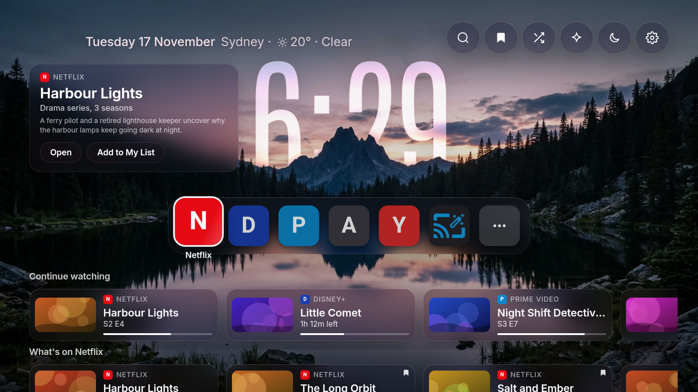
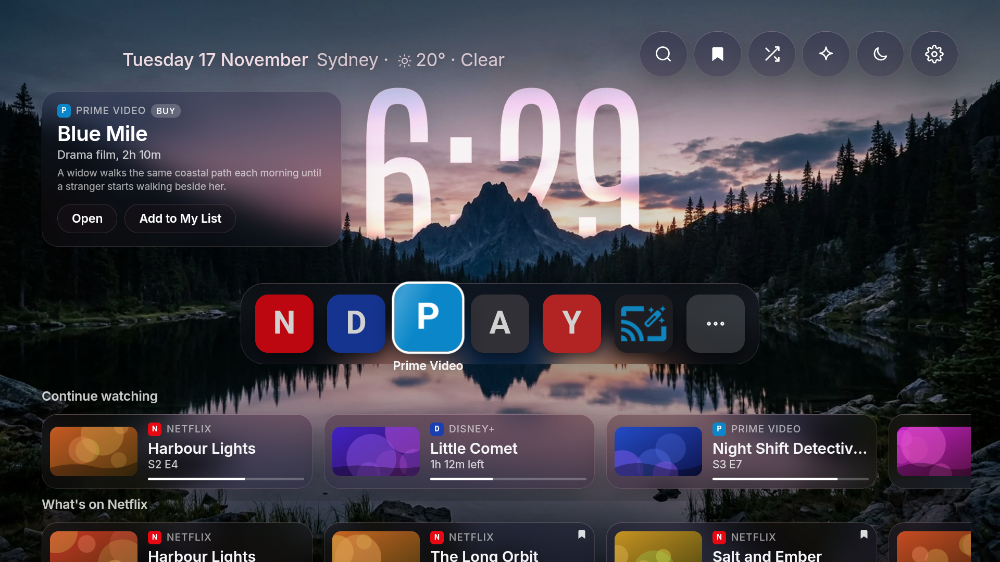
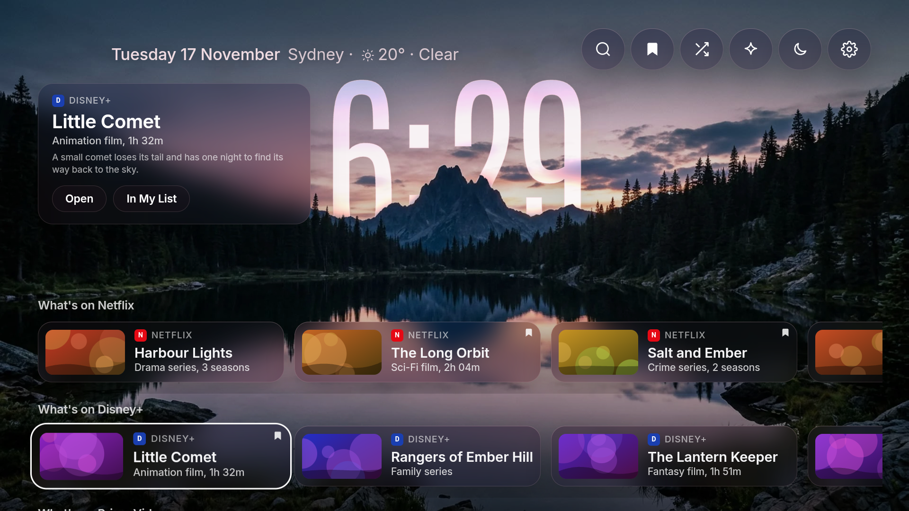
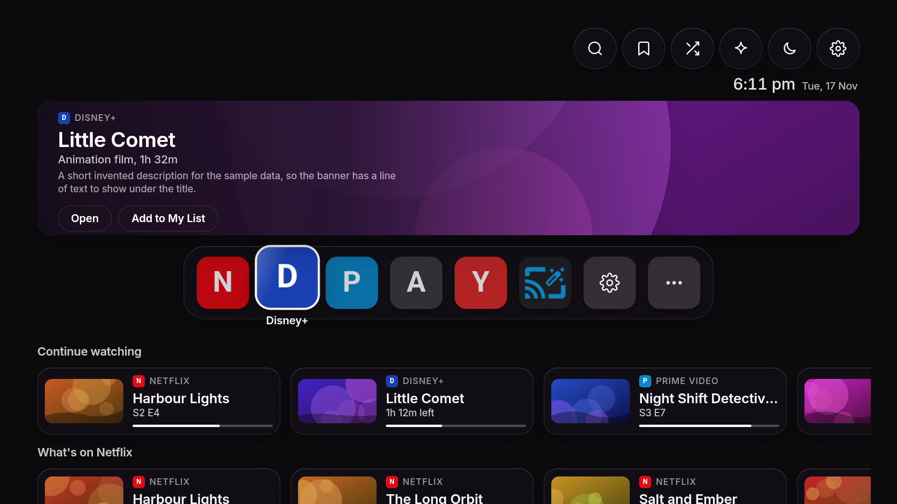
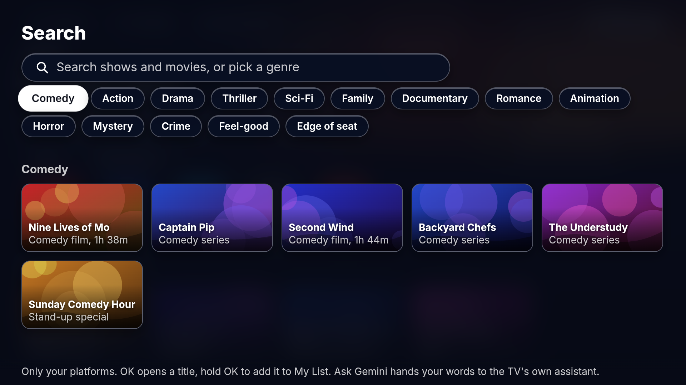
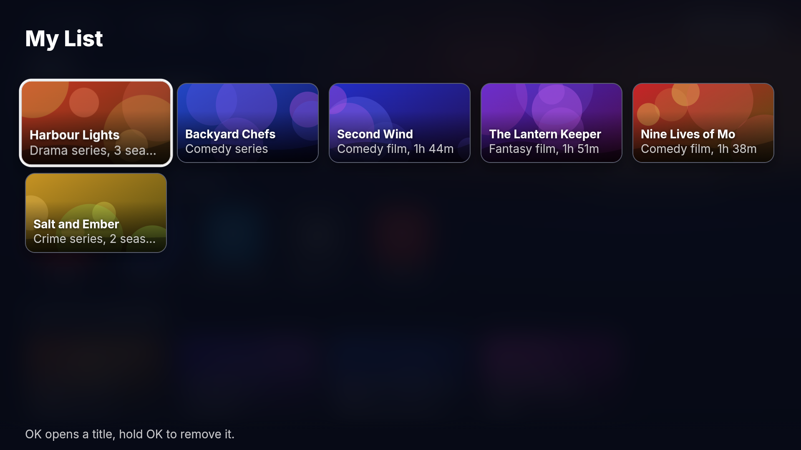
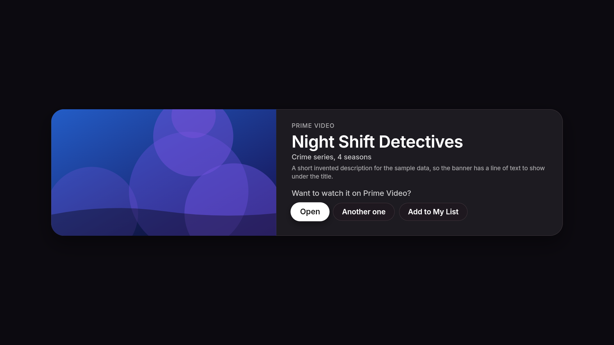

# tv-home

An Android / Google TV home screen I use on my TCL. Based on [couch-tv](https://github.com/Seagey/couch-tv) by Seagey (MIT),
substantially reworked. The look is still couch-tv's Night look: a scene behind a big glass clock, a glass dock of
apps, round glass buttons. The original copyright is kept in [LICENSE](LICENSE).



## What I changed
- **What's on rows.** Under your apps there is Continue watching (Android's own Watch Next list), then one
  "What's on Netflix / Disney+ / ..." row for each streaming app you actually have, in the order of your dock. The rows
  come from what those apps publish to the TV. You can switch each row off in Settings.
- **The banner follows the focus.** Move onto an app and the banner shows what that app is pushing right now.
  Turn the wallpaper off in Settings and the same area becomes a wide art banner instead of the scenes. Everything
  below it stays exactly the same.
- **Search** with an on-screen keyboard and genre and mood chips (Comedy, Feel-good, ...), limited to the apps you have.
  Rent and buy titles are marked.
- **My List**, kept on the TV. Add from the banner, any card or search; hold OK on a card for the menu.
- **Surprise me** picks a title and asks if you want to open it.
- **Gemini** button and "Ask Gemini" in search just hand over to the TV's own assistant. There is no AI in this app.
- **TMDB** is optional and off by default. With your own key in `config.json` it adds more titles for your region
  (NZ by default), with rent and buy offers. No key, no requests. No ads, ever: a test fails if the home touches a host
  that is not on a short list.
- No user profiles. Android / Google TV only.

| | |
|---|---|
|  |  |
|  |  |
|  |  |
|  |  |

The screenshots use sample titles and generated art (the `demo` setting), not real posters.

## Set it up
`./setup.sh` asks a few questions one at a time and writes a git-ignored `config.json`, or use the Settings
screen on the TV with the D-pad. Steps for a person or an AI agent are in [SETUP.md](SETUP.md).

## Build and install
JDK 21 and the Android SDK (platform 34).
```sh
sh scripts/build-apk.sh                    # APK in dist/, uses config.json if there is one
sh tv-home/tools/install.sh emulator-5554  # refuses anything but an emulator unless I_MEAN_A_REAL_TV=yes
```
The first start asks whether to make it your home screen. "Not now" keeps it as a normal app.

## Status and limits
Built and checked on the Android TV emulator only. Not tried yet on the real TV: replacing the TCL home with the Home
key, which apps actually publish rows (Netflix publishes little), how it feels with the real remote, and the Gemini
hand-off. TMDB titles open the streaming app, not the exact title. Undo: uninstall the app; the TCL home was never disabled.

## Credit
couch-tv by Seagey (MIT) is the base: design, scenes and most of the home code. Icons are [Feather](https://feathericons.com)
(MIT). Where-to-watch data, if you turn TMDB on, comes from TMDB and JustWatch: this product uses the TMDB API but is not
endorsed or certified by TMDB. Scene photos and fonts keep their own credits in `tv-home/web/backgrounds/CREDITS.md`.
