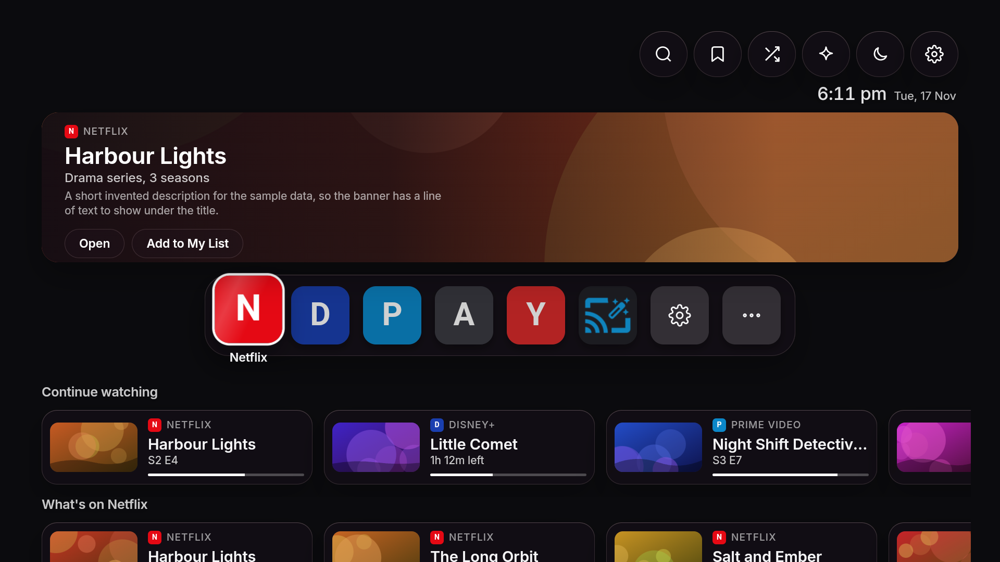
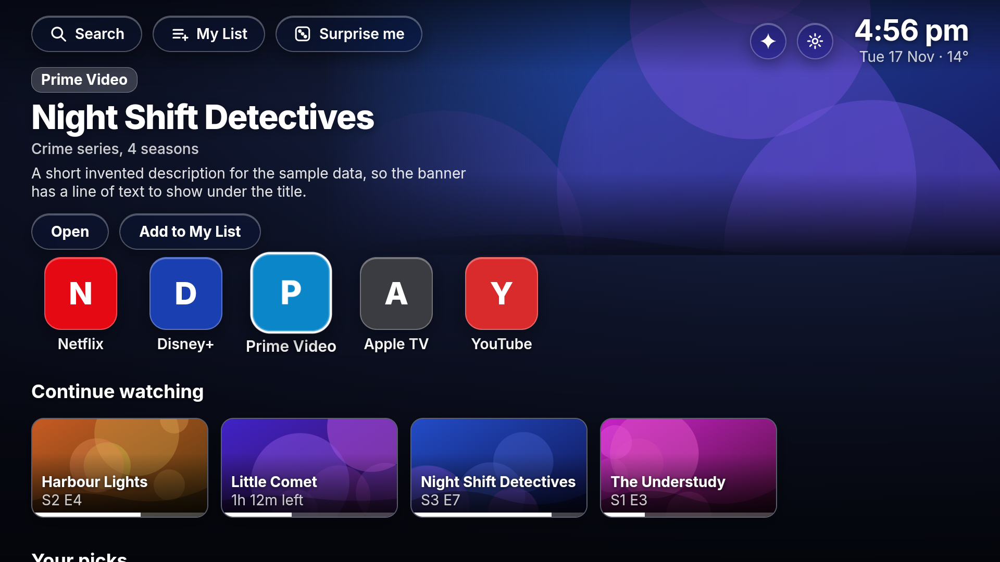
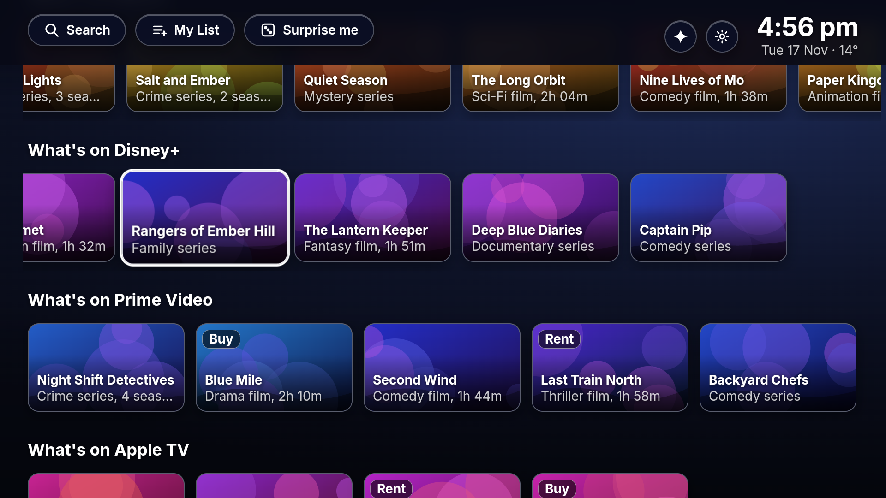
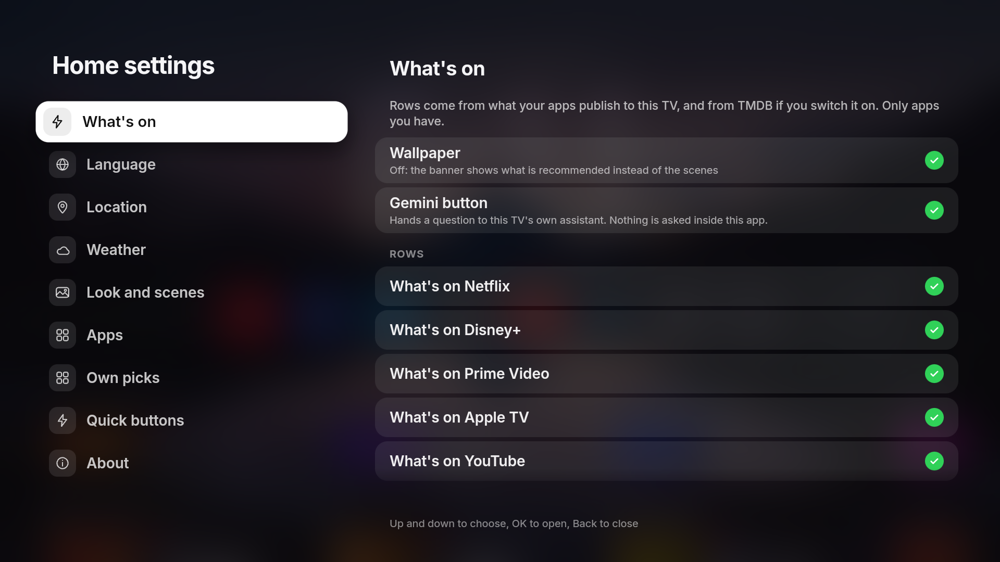

# TV home

Based on [couch-tv](https://github.com/Seagey/couch-tv) by Seagey (MIT), substantially reworked.

My own home screen for an Android / Google TV. I wanted Google TV's layout (search, clock, a big banner, rows of
things to watch) without Google's ads, and with rows that are actually about the streaming apps I pay for.


## What it does
- **Two looks, one home.** Full-screen wallpaper (the default), or a recommendations banner like Google TV's.
  The switch is in Settings and changes only the top area: the bars, rows, search and focus order are identical.
- **Top bar:** Search, My List and Surprise me on the left; a Gemini button, Settings and the clock on the right.
- **Apps row**, then **Continue watching** (Android's Watch Next list), then one **What's on ...** row per streaming
  app I have set up, in the same order as the apps row. Each row has its own switch in Settings.
- **Focus an app and the banner becomes that app's.** Its own published recommendations, not a guess.
- **Search** with typing and genre / mood sections (Comedy, Feel-good, ...). Only my platforms, rent and buy
  options included. Titles open in the app, with a deep link when the app published one.
- **My List** (saved on the TV; hold OK on any title to add or remove it), **Surprise me**, and my own picks row.
- **No ads, no sponsored tiles, no accounts, no AI in the app.** The Gemini button hands off to the TV's own assistant.








The pictures use invented sample titles and generated art, not real posters.

## Where the recommendations come from
1. **What the apps publish to the TV** (Android TV preview channels and Watch Next). It needs no key and no account,
   and it is personalised by each app. How much an app publishes is up to the app: [docs/RECOMMENDATIONS.md](docs/RECOMMENDATIONS.md).
2. **TMDB, optional and off by default.** With my own free API key it fills out the platform rows and search for the
   apps I have, in my country (`NZ`), including rent / buy, and ranks them by the genres in My List and Continue watching.
   The key lives in `config.json`, which git ignores.

Google's own home banner is not available to another home app, so this one never shows it.

*This product uses the TMDB API but is not endorsed or certified by TMDB. Streaming availability data is provided by JustWatch via TMDB.*

## Set it up
`./setup.sh` asks one question at a time (wallpaper or banner, apps, which platform rows, TMDB, Gemini button, clock,
picks, weather) and writes `config.json`. The Settings screen on the TV changes the same things with the D-pad.
Details for a person or an AI agent: [SETUP.md](SETUP.md). Every setting: [docs/CONFIG.md](docs/CONFIG.md).

## Build and install
JDK 21 and the Android SDK (platform 34, build-tools 34):
```sh
sh scripts/build-apk.sh                    # APK in dist/, uses config.json if present
sh tv-home/tools/install.sh emulator-5554  # one adb device; refuses anything but an emulator unless I_MEAN_A_REAL_TV=yes
```

## Status and limits
Built and checked on the Android TV emulator only; I have not run it on my own TV yet. What a particular app
publishes, how the Home button hands over from the TV's own home, and how the remote feels are all untested on real hardware.

## Undo
Uninstall it (`adb uninstall app.couchtv.launcher`). The TV's own home was never disabled.

## Credit
Original project and design: Seagey/couch-tv (MIT, copyright kept in [LICENSE](LICENSE)). Wallpaper photos and fonts keep their
credits in `tv-home/web/backgrounds/CREDITS.md`.

The settings gear icon is from [Feather](https://github.com/feathericons/feather) (MIT).
