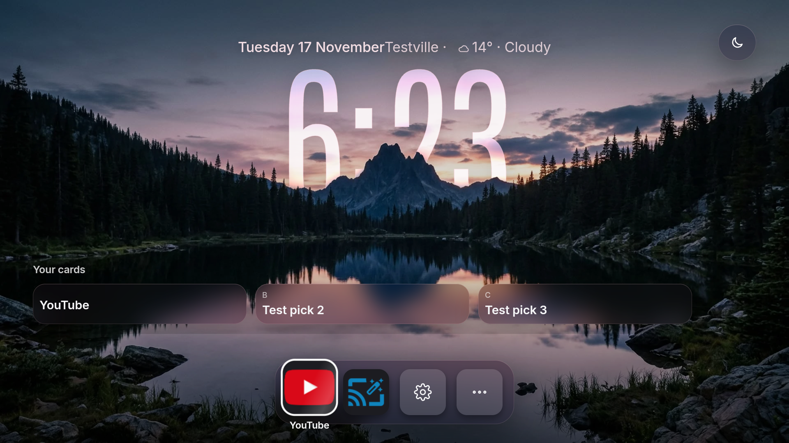
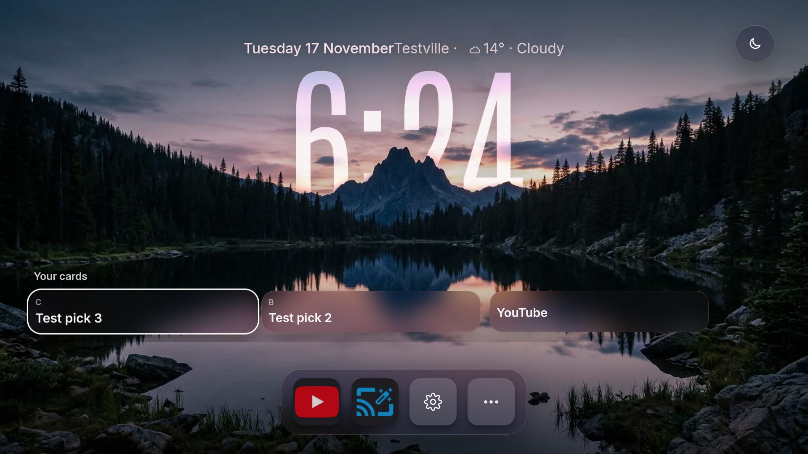
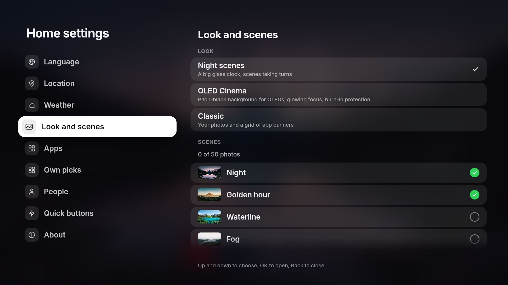
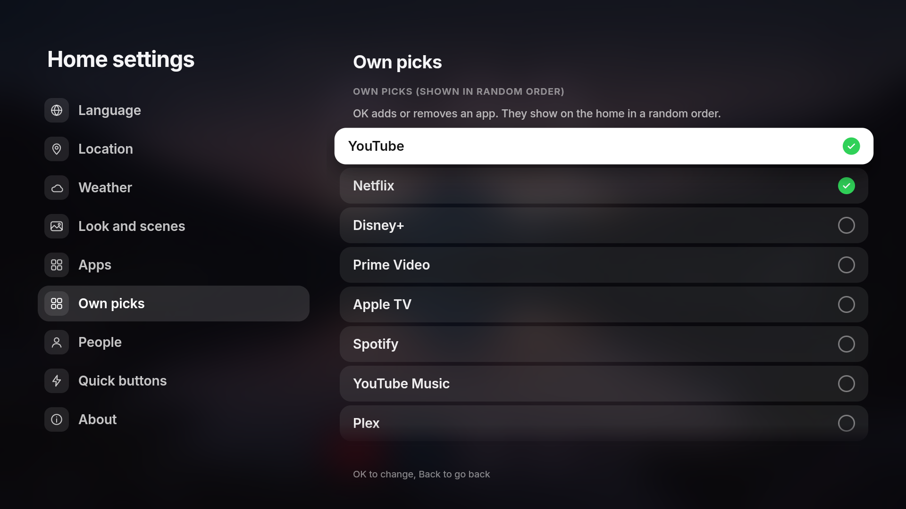

# TV home (personal fork)

> Fork of [Seagey/couch-tv](https://github.com/Seagey/couch-tv). MIT, with the original copyright kept in [LICENSE](LICENSE).

A replacement home screen for an Android / Google TV: a scene behind a big clock, a row of your apps, a shelf
of "keep watching" items and your own picks, and a weather line. It runs on the TV alone. Nothing here talks to
a phone, a bridge or an AI.



## What it does
- Shows the apps you choose, in the order you choose, over a rotating scene (or an OLED-black or classic grid look).
- **Keep watching:** reads Android's own Watch Next list, the same data Google's "Continue watching" row uses. Google's
  recommendation banner is not available to a replacement home, so it is not shown.
- **Own picks:** a shelf of cards you choose, in a random order every time the home opens. They come from your list, not from ads.
- Weather and clock. No ads: a test fails if the home ever references a host outside a short allowlist.



## What is different from upstream
Removed: the phone remote and web app, the bridge server, QR/pairing, the Claude assistant, the other TV brands
and Apple TV/Roku/Samsung/LG code, network discovery and the CI workflow. Added: `home.picks` and the Own picks
screen, `home.app_order`, an interactive setup, a no-ads test and emulator tests. Self-update is off. Details are in
[CHANGELOG.md](CHANGELOG.md) and [docs/TRACK-A.md](docs/TRACK-A.md). Remote control of the TV is handled elsewhere (Home Assistant).

## Set it up
Two ways, same choices: `./setup.sh` (questions in a terminal, writes a git-ignored `config.json`) or the TV's own
Home settings screen, with the D-pad only. Full steps, for a person or an AI agent: [SETUP.md](SETUP.md).

| On the TV | |
|---|---|
|  |  |

## Build and install
Needs JDK 21 and the Android SDK (platform 34, build-tools 34).
```sh
sh scripts/build-apk.sh                    # APK in dist/, config.json is used if present, otherwise config.example.json
sh tv-home/tools/install.sh emulator-5554  # one adb device; refuses anything but an emulator unless I_MEAN_A_REAL_TV=yes
```
The first run asks whether to make it the home screen; "Not now" keeps it as a normal app.

## Tests
```sh
for f in tests/*.js; do node $f; done; python3 -I tests/test_setup.py; sh tests/test_no_ads.sh
# Android TV emulator (API 34), a debug build installed, python with `websockets`:
sh tests/emulator/run_all.sh <python>      # focus order, Watch Next, picks row, the setup screen
```
The emulator tests only ever talk to `emulator-5554`.

## Limits: what is only proven on the emulator
Everything above. Not tried on a real TV: taking over from the maker's home with the Home key, any ad row the TV
maker adds, which apps publish Watch Next entries, and how focus feels with a real remote. The TV's setup screen
saves on the TV; it can't write `config.json` back.

## Undo
Uninstall the app (`adb uninstall app.couchtv.launcher`) or from the TV's app settings. The maker's own home was never
disabled. If the TV ever shows the wrong home, press Home and choose the TV's own.

## Credit
Original project and design: Seagey/couch-tv (MIT). Scene photos and fonts keep their own credits in `tv-home/web/backgrounds/CREDITS.md`.
